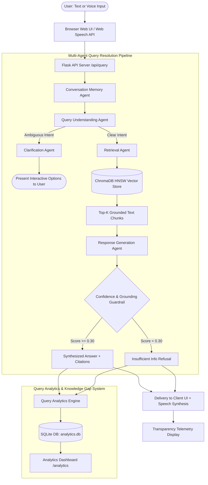
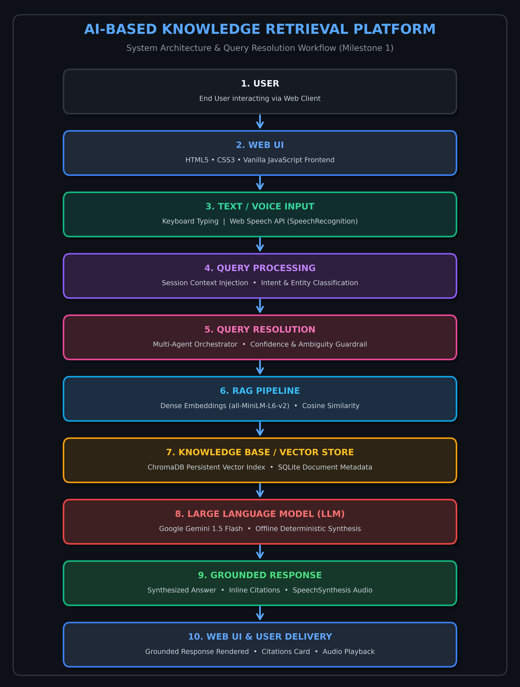

# AI-Based Knowledge Retrieval Platform with Query Resolution System

> **A full-stack enterprise platform combining Multi-Agent Retrieval-Augmented Generation (RAG), multimodal speech input/output, response transparency telemetry, and automated query analytics with knowledge gap detection.**

[](https://www.python.org/)
[](https://flask.palletsprojects.com/)
[](https://www.trychroma.com/)
[](https://huggingface.co/sentence-transformers/all-MiniLM-L6-v2)
[](https://ai.google.dev/)
[](https://developer.mozilla.org/en-US/docs/Web/API/Web_Speech_API)
[](https://sqlite.org/)

---

## Table of Contents

1. [Project Overview](#project-overview)
2. [Problem Statement & Solution](#problem-statement--solution)
3. [Key Capabilities](#key-capabilities)
4. [Technology Stack](#technology-stack)
5. [System Architecture](#system-architecture)
6. [Complete Query Resolution Pipeline](#complete-query-resolution-pipeline)
7. [Repository Structure](#repository-structure)
8. [Installation and Setup](#installation-and-setup)
9. [Environment Configuration](#environment-configuration)
10. [How to Run the Application](#how-to-run-the-application)
11. [Knowledge Ingestion & Vector Indexing](#knowledge-ingestion--vector-indexing)
12. [User Guide & Features Walkthrough](#user-guide--features-walkthrough)
13. [API Documentation & Reference](#api-documentation--reference)
14. [Testing & Validation](#testing--validation)
15. [Query Analytics & Knowledge Gap Detection](#query-analytics--knowledge-gap-detection)
16. [Knowledge Domains & Sample Queries](#knowledge-domains--sample-queries)
17. [Security, Privacy & Guardrails](#security-privacy--guardrails)
18. [Troubleshooting](#troubleshooting)
19. [Future Roadmap](#future-roadmap)
20. [License & Acknowledgments](#license--acknowledgments)

---

## Project Overview

The **AI-Based Knowledge Retrieval Platform with Query Resolution System** is an enterprise-grade AI knowledge platform built to accurately resolve complex inquiries against heterogeneous organizational documents (**PDF, DOCX, TXT, CSV**).

Instead of relying on basic vector search or ungrounded generative models, the platform uses an **orchestrated multi-agent pipeline** comprising five specialized agents:
1. **Conversation Memory Agent**: Manages session state, tracks discussion topics, and resolves ambiguous pronouns (*"it"*, *"them"*, *"its"*).
2. **Query Understanding Agent**: Classifies user queries by intent (*factual*, *procedural*, *comparative*, *ambiguous*, *out-of-scope*) and extracts domain entities.
3. **Clarification Agent**: Intercepts underspecified queries and generates interactive options before querying the vector store.
4. **Retrieval Agent**: Conducts dense semantic search over persistent ChromaDB HNSW vector indices using 384-dimensional `all-MiniLM-L6-v2` embeddings.
5. **Response Generation Agent**: Synthesizes verified, source-grounded answers with exact citations, application confidence labels, and fallback refusal guardrails.

The application includes browser-native **voice interaction** (speech-to-text and text-to-speech), a **Response Transparency Panel** displaying step execution metrics, and an integrated **Query Analytics & Knowledge Gap Engine** with a real-time web dashboard.

---

## Problem Statement & Solution

### The Challenge
- **Keyword Inefficiency**: Standard keyword search fails when queries contain natural paraphrasing or conceptual phrasing.
- **Context Loss**: Traditional search engines cannot sustain multi-turn conversational dialogue or resolve pronouns across turns.
- **Hallucinations**: Direct queries to LLMs frequently produce plausible-sounding but completely fabricated facts.
- **Opacity**: Standard AI assistants do not provide verifiable evidence, source citations, or similarity distances.
- **Documentation Blindspots**: IT and HR managers have no visibility into the unanswered questions users ask repeatedly.

### The Solution
- **Dense Vector Search**: Semantic retrieval powered by ChromaDB HNSW cosine indexing with local sentence-transformers.
- **Multi-Agent Decomposition**: Distinct, specialized agents handle memory, classification, clarification, search, and synthesis.
- **Strict Grounding Guardrails**: Automatically refuses out-of-scope questions ($< 0.30$ relevance score) rather than hallucinating.
- **Multimodal Accessibility**: Browser-native voice input and audio synthesis with zero paid cloud voice dependencies.
- **Continuous Knowledge Evolution**: An automated analytics engine clusters low-confidence inquiries in SQLite to flag missing documentation.

---

## Key Capabilities

- **Heterogeneous Document Ingestion**: Ingests `.pdf`, `.docx`, `.txt`, and `.csv` files using sliding-window chunking (500 characters, 50-character overlap).
- **Five Pre-Configured Knowledge Domains**:
  - **AI / Machine Learning**: Transformers, LLMs, RAG architectures, supervised/unsupervised learning, fine-tuning.
  - **Cloud Computing**: IaaS, PaaS, SaaS, multi-cloud architectures, cloud storage, CDNs, serverless computing.
  - **Cybersecurity**: Zero Trust Architecture, CIA Triad, AES-256 and RSA cryptography, firewalls, incident response.
  - **Corporate HR Policies**: Leave entitlements, code of conduct, remote work, compensation.
  - **Product Technical Manuals**: CloudSync Pro installation, command-line operations, backup configurations.
- **Dual-Mode LLM Synthesis**: Connects to **Google Gemini 1.5 Flash** when configured, and falls back automatically to an **offline local synthesis engine** if no API key is provided.
- **Voice I/O Subsystem**: Real-time microphone audio transcription (with Indian English `en-IN` phonetic optimization) and text-to-speech audio with playback controls (Speak, Pause, Resume, Stop).
- **Auditability & Transparency**: Real-time panel exposing step execution timings (ms), classification confidence, similarity metrics, and chunk contents.
- **Interactive Clarification**: Ambiguous queries receive selectable chips allowing users to disambiguate intent before retrieval.
- **Automated Knowledge Gap Detection**: N-gram extraction and frequency clustering over low-confidence/unanswered queries to flag missing documentation.
- **Administrative Dashboard**: Real-time web interface at `/analytics` visualizing resolution rates, domain distribution, intent breakdown, and execution logs.
- **Automated Test Suite**: 47 automated tests verifying end-to-end user workflows, intent classification, vector search, clarification, and voice simulation.

---

## Technology Stack

| Layer | Component | Technology | Role in Architecture |
| :--- | :--- | :--- | :--- |
| **Frontend** | User Interface | **HTML5, CSS3, Vanilla JavaScript** | Dark glassmorphic responsive client with no Node.js build overhead. |
| **Voice I/O** | Multimodal Audio | **W3C Web Speech API** | Browser-native `webkitSpeechRecognition` & `SpeechSynthesis` (`en-IN` locale). |
| **Backend** | REST API Server | **Python 3.9+ & Flask 3.1** | Modular application server ([`src/app.py`](src/app.py)) dispatching agent pipelines. |
| **Vector DB** | Vector Index | **ChromaDB (HNSW)** | Persistent vector database using Cosine distance nearest-neighbor search. |
| **Embeddings** | Semantic Vectors | **Sentence-Transformers** | `all-MiniLM-L6-v2` generating 384-dimensional dense vectors locally on CPU. |
| **Text Splitter**| Preprocessing | **Recursive Sliding Window** | 500-character chunks with 50-character overlap preserving sentence boundaries. |
| **LLM Engine** | Answer Synthesis | **Google Gemini 1.5 Flash** | Context-grounded response generation with offline local synthesis fallback. |
| **Parsers** | Document Ingestion | **PyPDF & Python-Docx** | Native text extraction for PDF, DOCX, TXT, and CSV file formats. |
| **Telemetry** | Query Logs & Gaps | **SQLite3** | Relational store ([`data/analytics.db`](data/analytics.db)) tracking query metrics and gap clusters. |
| **Testing** | Automated Quality | **Python `unittest`** | Automated unit and full-pipeline integration test suites. |

---

## System Architecture





---

## Complete Query Resolution Pipeline

```text
[User Inquires via Text or Voice]
               │
               ▼
   [1. Ingestion / Pre-load Check]
   Does ChromaDB have indexed documents?
   ├── No  --> Automatically index default knowledge domains into ChromaDB
   └── Yes --> Proceed to query resolution
               │
               ▼
   [2. Session Memory Lookup]
   Retrieve previous turns for session_id.
   Resolve ambiguous references (e.g., "its features" -> "CloudSync Pro features").
               │
               ▼
   [3. Query Understanding & Classification]
   Classify intent: factual | procedural | comparative | ambiguous | out_of_scope.
   Extract domain keywords, entities, and classification confidence score.
               │
               ▼
   [4. Ambiguity Guardrail]
   Is query ambiguous or under-specified?
   ├── Yes --> Clarification Agent returns structured options to user (Execution pauses)
   └── No  --> Proceed to vector retrieval
               │
               ▼
   [5. Vector Retrieval]
   Encode query using all-MiniLM-L6-v2 (384-d).
   Query ChromaDB HNSW index in Cosine space (Top-K = 3 to 5 chunks).
   Filter and rank chunks by relevance score.
               │
               ▼
   [6. Response Synthesis & Anti-Hallucination]
   Top score < 0.30?
   ├── Yes --> Return polite refusal ("Sufficient information was not found..."). Avoid hallucination.
   └── No  --> Synthesize answer strictly from retrieved context (Gemini or Local Engine).
               Attach exact source citations (document_name, page, chunk_id).
               │
               ▼
   [7. Client Delivery & Multimodal Audio]
   Return JSON payload with answer, confidence, sources, and step telemetry.
   Render markdown in UI; optionally speak answer via SpeechSynthesis.
               │
               ▼
   [8. Analytics & Knowledge Gap Recording]
   Record query text, domain, intent, confidence, resolution status, and latency into SQLite.
   If query resulted in refusal or low confidence, flag cluster as an actionable Knowledge Gap.
```

---

## Repository Structure

```text
rag/
├── src/                                   # Application Source Code
│   ├── __init__.py
│   ├── app.py                             # Main Unified Flask API & Web Server
│   │
│   ├── agents/                            # Autonomous AI Agent Implementations
│   │   ├── __init__.py
│   │   ├── query_understanding_agent.py   # Intent classification & domain keyword routing
│   │   ├── retrieval_agent.py             # ChromaDB vector search & relevance filtering
│   │   ├── response_generation_agent.py   # Grounded synthesis, citations & refusal guardrails
│   │   ├── clarification_agent.py         # Ambiguity detection & interactive follow-up generation
│   │   └── conversation_memory_agent.py   # Contextual memory & pronoun resolution
│   │
│   ├── orchestration/                     # Multi-Agent Coordination Pipeline
│   │   ├── __init__.py
│   │   └── orchestrator.py                # Sequential pipeline coordinator
│   │
│   ├── retrieval/                         # Vector Search & RAG Ingestion Engine
│   │   ├── __init__.py
│   │   ├── chunking.py                    # Recursive sliding-window chunking (500 chars / 50 overlap)
│   │   ├── embeddings.py                  # 384-d dense embedding generator (all-MiniLM-L6-v2)
│   │   └── vector_store.py                # ChromaDB HNSW vector database manager
│   │
│   ├── memory/                            # Dialogue History & Entity State
│   │   ├── __init__.py
│   │   └── conversation_memory.py         # Session turn storage & contextual reference resolver
│   │
│   ├── analytics/                         # Telemetry & Knowledge Gap Engine
│   │   ├── __init__.py
│   │   └── query_analytics.py             # SQLite query logger & knowledge gap detection engine
│   │
│   ├── static/                            # Frontend Static Web Assets
│   │   ├── css/
│   │   │   └── style.css                  # Dark glassmorphic styling
│   │   └── js/
│   │       ├── main.js                    # Chat UI controller, drag & drop, and socket/fetch calls
│   │       ├── speech_recognition.js      # Web Speech API voice input (en-IN tuned)
│   │       ├── text_to_speech.js          # Speech synthesis audio output with playback controls
│   │       └── transparency_panel.js      # Runtime telemetry & citation evidence display
│   │
│   └── templates/                         # HTML UI Templates
│       ├── index.html                     # Primary Knowledge Retrieval Assistant Interface
│       └── analytics.html                 # Real-time Query Analytics & Gap Dashboard
│
├── knowledge_base/                        # Consolidated Enterprise Domain Documents
│   ├── ai_ml_knowledge.txt                # AI/ML Technical Domain (Supervised/Unsupervised, LLMs, RAG)
│   ├── cloud_computing_knowledge.txt      # Cloud Computing Domain (IaaS/PaaS/SaaS, Multi-cloud)
│   ├── cybersecurity_knowledge.txt        # Cybersecurity Domain (Zero Trust, CIA Triad, AES-256)
│   ├── hr_policy.txt                      # Corporate HR Guidelines & Leave Entitlements
│   ├── product_manual.txt                 # CloudSync Pro Technical Reference
│   └── uploads/                           # Destination for user-uploaded documents
│
├── scripts/                               # Maintenance & Operations
│   └── ingest_knowledge_base.py           # Unified vector ingestion script for all 5 knowledge domains
│
├── tests/                                 # Consolidated Automated Test Suite
│   ├── __init__.py
│   ├── test_e2e.py                        # 10 Full-Pipeline End-to-End integration tests
│   ├── test_query_understanding.py        # Intent classification & entity extraction tests
│   ├── test_retrieval.py                  # ChromaDB vector retrieval & threshold tests
│   ├── test_response_generation.py        # Grounded synthesis & anti-hallucination tests
│   ├── test_clarification.py              # Ambiguity detection & option generation tests
│   ├── test_memory.py                     # Multi-turn memory & pronoun resolution tests
│   ├── test_transparency.py               # Runtime telemetry & latency trace tests
│   └── test_voice.py                      # Voice input normalization tests
│
├── docs/                                  # Technical Documentation
│   ├── architecture.md                    # Comprehensive system architecture & data flow
│   ├── api_reference.md                   # REST API documentation, routes, and schemas
│   ├── data_specifications.md             # Formal JSON contracts (Input, Processing, Retrieval, Output)
│   ├── demo_walkthrough.md                # 6-scenario demonstration walkthrough script
│   ├── optimization_report.md             # Retrieval, voice, and guardrail optimization benchmarks
│   ├── testing_guide.md                   # Testing strategy, execution commands, and matrix
│   └── assets/
│       └── system_architecture.png        # High-resolution architectural diagram
│
├── data/                                  # Runtime Persistent Storage (Ignored by Git)
│   ├── .gitkeep
│   ├── analytics.db                       # SQLite query telemetry database
│   └── vectorstore/                       # ChromaDB persistent vector database directory
│
├── README.md                              # Complete Unified Platform Documentation
├── requirements.txt                       # Verified Python Package Dependencies
└── .gitignore                             # Clean Ignore Rules (caches, DBs, chroma storage, venvs)
```

---

## Installation and Setup

### Prerequisites

- **Python**: Version 3.9, 3.10, or 3.11.
- **Web Browser**: Google Chrome or Microsoft Edge (recommended for Web Speech API audio features).
- **Git**: Installed and available in terminal path.

### Step-by-Step Setup

1. **Clone the Repository**:
   ```bash
   git clone https://github.com/gopikasri27/Development-of-AI-Based-Knowledge-Retrieval-Platform-with-Query-Resolution-System.git
   cd Development-of-AI-Based-Knowledge-Retrieval-Platform-with-Query-Resolution-System
   ```

2. **Create and Activate a Virtual Environment**:
   - **Windows (PowerShell)**:
     ```powershell
     python -m venv .venv
     .\.venv\Scripts\Activate.ps1
     ```
   - **Linux / macOS**:
     ```bash
     python3 -m venv .venv
     source .venv/bin/activate
     ```

3. **Install Dependencies**:
   ```bash
   python -m pip install --upgrade pip
   pip install -r requirements.txt
   ```

---

## Environment Configuration

The application operates in **dual-mode**:
1. **Gemini API Mode**: Connects to Google Gemini 1.5 Flash for natural answer synthesis.
2. **Offline Local Synthesis Mode**: Automatically activates the built-in rule-based local synthesis engine if no API key is provided. Zero external API keys are required to run or test the platform.

### Setting the Optional Gemini API Key

- **Windows PowerShell**:
  ```powershell
  $env:GEMINI_API_KEY="your_actual_gemini_api_key_here"
  ```
- **Linux / macOS**:
  ```bash
  export GEMINI_API_KEY="your_actual_gemini_api_key_here"
  ```

### Custom Port Configuration

The server defaults to port `5000`. To customize:
```bash
# Windows PowerShell
$env:PORT="5001"

# Linux / macOS
export PORT=5001
```

---

## How to Run the Application

### 1. Ingest the Knowledge Base Documents
Before launching, index the 5 enterprise knowledge documents into the ChromaDB vector store:
```bash
python scripts/ingest_knowledge_base.py
```

### 2. Start the Unified Server
Launch the primary Flask web application:
```bash
python src/app.py
```

Output:
```text
 * Serving Flask app 'app'
 * Debug mode: off
 * Running on all addresses (0.0.0.0)
 * Running on http://127.0.0.1:5000
```

### 3. Open in Browser
- **Main Chat & RAG Assistant UI**: [`http://localhost:5000/`](http://localhost:5000/)
- **Query Analytics & Knowledge Gap Dashboard**: [`http://localhost:5000/analytics`](http://localhost:5000/analytics)
- **API Health Check**: [`http://localhost:5000/api/health`](http://localhost:5000/api/health)

---

## Knowledge Ingestion & Vector Indexing

The platform supports three distinct ingestion mechanisms:

### Method 1: Automated Script Ingestion
```bash
python scripts/ingest_knowledge_base.py
```
Indexes `ai_ml_knowledge.txt`, `cloud_computing_knowledge.txt`, `cybersecurity_knowledge.txt`, `hr_policy.txt`, and `product_manual.txt` into ChromaDB.

### Method 2: Web UI Drag-and-Drop
1. Navigate to [`http://localhost:5000/`](http://localhost:5000/).
2. Drag and drop any `.pdf`, `.docx`, `.txt`, or `.csv` file into the left-hand **Knowledge Ingestion** dropzone.
3. The server parses text, divides it into 500-character chunks with 50-character overlap, generates 384-dimensional embeddings, and stores them in ChromaDB.
4. The uploaded file immediately appears in the **Indexed Documents** sidebar.

### Method 3: REST API Upload
```bash
curl -X POST http://localhost:5000/api/upload \
  -F "file=@knowledge_base/cybersecurity_knowledge.txt"
```

---

## User Guide & Features Walkthrough

### 1. Natural Language Querying
Type any question into the input bar and press **Enter** or click **Send**. The response displays:
- Grounded answer.
- Confidence label (`High`, `Medium`, `Low`).
- Verifiable source citations (document name, chunk ID, relevance score).

### 2. Multimodal Voice Input
- Click the **Microphone** icon in the input bar.
- Speak your inquiry aloud (e.g., *"What are the core principles of Zero Trust Architecture?"*).
- Real-time speech transcription (tuned for `en-IN` English) transcribes the speech into the query field.

### 3. Speech Audio Output
- Toggle the **Voice Output** switch in the header.
- Responses are read aloud using the browser's speech synthesis engine.
- Use the controls to **Speak**, **Pause**, **Resume**, or **Stop** audio playback.

### 4. Interactive Clarification
- Submit an underspecified inquiry such as *"Tell me about cloud deployment"*.
- The Clarification Agent intercepts the query and presents clickable options:
  - *Public Cloud vs Private Cloud*
  - *IaaS, PaaS, and SaaS Service Models*
  - *Cloud Storage & Security Options*
- Clicking an option instantly submits the clarification and retrieves the specific answer.

### 5. Multi-Turn Conversation Memory
- Test contextual follow-up questions:
  - **Turn 1**: *"What is the CIA triad in cybersecurity?"*
  - **Turn 2**: *"What does confidentiality mean within it?"*
- The Conversation Memory Agent resolves *"it"* to the CIA triad from the previous turn without manual rephrasing.

### 6. Response Transparency Panel
- Expand the **Transparency Panel** on the right side of the interface.
- View step execution durations (Query Understanding $\to$ Retrieval $\to$ Synthesis), classification confidence scores, vector similarity distances, and raw text chunk contents.

### 7. Query Analytics Dashboard
- Navigate to [`http://localhost:5000/analytics`](http://localhost:5000/analytics).
- Review aggregate query statistics, resolution rates, domain distribution charts, intent breakdowns, and identified **Knowledge Gap Alerts**.

---

## API Documentation & Reference

The Flask application exposes RESTful JSON endpoints on port `5000`:

| Endpoint | Method | Purpose |
| :--- | :---: | :--- |
| `/` | `GET` | Serves the main Assistant Web UI. |
| `/api/query` | `POST` | Executes the complete multi-agent query resolution pipeline. |
| `/api/clarify` | `POST` | Submits user selection to resolve an active clarification prompt. |
| `/api/memory/<session_id>` | `GET`, `DELETE` | Retrieves or clears conversation memory for a session. |
| `/api/upload` | `POST` | Uploads and indexes a document (PDF, DOCX, TXT, CSV) into ChromaDB. |
| `/api/ingest` | `POST` | Re-indexes specific knowledge base files or resets vector store. |
| `/api/health` | `GET` | Returns system health, indexed chunk counts, and Gemini status. |
| `/documents` | `GET` | Returns list of currently indexed document names. |
| `/analytics` | `GET` | Serves the Query Analytics & Knowledge Gap Dashboard. |
| `/api/analytics/stats` | `GET` | Returns aggregated metrics (resolution rate, domain/intent breakdown). |
| `/api/analytics/gaps` | `GET` | Returns detected knowledge gap clusters from low-confidence queries. |
| `/api/analytics/queries` | `GET` | Returns recent query execution logs with optional filtering. |
| `/api/analytics/topics` | `GET` | Returns frequently asked topics and entity clusters. |

### Sample Request: `POST /api/query`
```json
{
  "query": "What are the core principles of Zero Trust Architecture?",
  "session_id": "user_session_101",
  "clarification_response": null
}
```

### Sample Response: `POST /api/query`
```json
{
  "query": "What are the core principles of Zero Trust Architecture?",
  "answer": "Zero Trust Architecture is a cybersecurity paradigm built on the principle 'Never Trust, Always Verify'...",
  "is_clarification": false,
  "query_type": "factual",
  "classification_confidence": 0.95,
  "confidence": {
    "score": 0.88,
    "label": "High"
  },
  "sources": [
    {
      "document_name": "cybersecurity_knowledge.txt",
      "chunk_id": "cybersecurity_knowledge.txt_chunk_12",
      "page": 1,
      "relevance_score": 0.88
    }
  ],
  "transparency": {
    "steps": [
      { "name": "Memory Resolution", "status": "completed", "duration_ms": 2 },
      { "name": "Query Understanding", "status": "completed", "duration_ms": 14 },
      { "name": "Context Retrieval", "status": "completed", "duration_ms": 38 },
      { "name": "Response Generation", "status": "completed", "duration_ms": 210 }
    ]
  },
  "telemetry": {
    "pipeline_execution_time_ms": 264
  }
}
```

---

## Testing & Validation

The platform includes a consolidated automated test suite in [`tests/`](tests/).

### Executing the Test Suites

#### 1. Full-Pipeline End-to-End Suite
```bash
python tests/test_e2e.py
```
Validates 10 scenarios:
- `TC-01`: Factual query resolution with citations from `ai_ml_knowledge.txt` (**PASS**)
- `TC-02`: Procedural 4-step query explanation generation (**PASS**)
- `TC-03`: Comparative matrix generation for IaaS, PaaS, and SaaS (**PASS**)
- `TC-04`: Ambiguous query detection and clarification option generation (**PASS**)
- `TC-05`: Multi-turn conversational memory pronoun resolution (**PASS**)
- `TC-06`: Context switching between Cloud and Cybersecurity domains (**PASS**)
- `TC-07`: Simulated voice input query processing and normalization (**PASS**)
- `TC-08`: Out-of-scope query refusal without hallucination (**PASS**)
- `TC-09`: Transparency telemetry execution trace verification (**PASS**)
- `TC-10`: SQLite analytics query logging and knowledge gap detection (**PASS**)

#### 2. Individual Unit & Integration Suites
```bash
# Agent & Feature Tests
python tests/test_query_understanding.py
python tests/test_retrieval.py
python tests/test_orchestration.py
python tests/test_clarification.py
python tests/test_memory.py
python tests/test_transparency.py
python tests/test_voice.py
```

#### 3. Automated Test Discovery
```bash
python -m unittest discover -s tests -p "test_*.py"
```

---

## Query Analytics & Knowledge Gap Detection

The **Query Analytics Engine** ([`src/analytics/query_analytics.py`](src/analytics/query_analytics.py)) persists all execution telemetry to SQLite ([`data/analytics.db`](data/analytics.db)).

### Telemetry Attributes
- `timestamp`: UTC execution time.
- `session_id`: Session identifier.
- `query`: User question string.
- `knowledge_domain`: Inferred domain (`AI/ML`, `Cloud Computing`, `Cybersecurity`, `HR & Policy`).
- `query_type`: Intent category (`factual`, `procedural`, `comparative`, `ambiguous`, `out_of_scope`).
- `response_confidence`: Numerical score ($0.00$ to $1.00$).
- `resolution_status`: Status (`Answered`, `Low Confidence`, `Unanswered`, `Clarification Required`).
- `retrieved_chunks`: Count of retrieved context passages.

### Knowledge Gap Detection Algorithm
When user inquiries result in low confidence ($< 0.30$) or explicit refusal, the engine cleans stop-words, extracts unigrams and bi-grams, groups them by domain, and aggregates clusters meeting the frequency threshold ($\ge 1$). These alerts are rendered in real time on the **Analytics Dashboard** to inform documentation updates.

---

## Knowledge Domains & Sample Queries

| Domain | File | Sample Inquiries | Expected Behavior |
| :--- | :--- | :--- | :--- |
| **AI / ML** | `ai_ml_knowledge.txt` | *"What is machine learning and how does supervised learning differ from unsupervised learning?"* | Factual grounded definition with citations and high confidence. |
| **AI / ML** | `ai_ml_knowledge.txt` | *"How does semantic search work step by step in RAG systems?"* | Procedural step-by-step breakdown (Chunking $\to$ Embeddings $\to$ HNSW $\to$ Generation). |
| **Cloud** | `cloud_computing_knowledge.txt` | *"Compare IaaS, PaaS, and SaaS cloud deployment models."* | Comparative matrix outlining management responsibility boundaries. |
| **Security** | `cybersecurity_knowledge.txt` | *"Explain the core principles of Zero Trust Architecture."* | Synthesis of "Never Trust, Always Verify", microsegmentation, and least-privilege. |
| **Security** | `cybersecurity_knowledge.txt` | *"What is the difference between AES-256 and RSA encryption?"* | Explains symmetric vs. asymmetric encryption, key lengths, and use cases. |
| **HR** | `hr_policy.txt` | *"How many days of annual leave do employees receive per year?"* | Direct extraction of HR leave entitlement (20 days annual, 10 days sick). |
| **Product** | `product_manual.txt` | *"How do I configure automatic cloud backups in CloudSync Pro?"* | Procedural step-by-step configuration steps from manual. |
| **Ambiguous** | N/A | *"Tell me about cloud deployment."* | Triggers clarification options; pauses retrieval until user selects option. |
| **Memory** | N/A | Turn 1: *"What is CIA triad?"*<br>Turn 2: *"What does confidentiality mean within it?"* | Resolves *"it"* to the CIA triad and explains confidentiality in security context. |
| **Out-of-Scope**| N/A | *"What will be the weather forecast in Tokyo tomorrow morning?"* | Refuses answer safely without hallucinating; logs inquiry as a knowledge gap. |

---

## Security, Privacy & Guardrails

- **Zero Speculative Generation**: Refusal triggers whenever context relevance falls below $0.30$.
- **Local Dense Embeddings**: Embeddings run on the local CPU via Sentence-Transformers `all-MiniLM-L6-v2`, preventing document transmission to external third-party embedding services.
- **Local Vector & Telemetry Storage**: ChromaDB vectors and SQLite telemetry logs persist on the local host.
- **Credential Isolation**: All API keys are loaded strictly from environment variables (`GEMINI_API_KEY`).
- **Web Security**: Configured with CORS headers and `Permissions-Policy: microphone=*` to allow speech recognition while protecting client resources.

---

## Troubleshooting

| Symptom | Probable Cause | Solution |
| :--- | :--- | :--- |
| **Microphone not functioning** | Browser permission blocked or non-Chromium browser. | Use Google Chrome or Microsoft Edge. Grant microphone permission in the browser address bar. |
| **Port 5000 in use** | Another local service is using port 5000. | Set `$env:PORT="5001"` in PowerShell and run `python src/app.py`. Open `http://localhost:5001`. |
| **Gemini API key warning** | `GEMINI_API_KEY` is not set. | The platform runs automatically using its built-in offline local synthesis engine. To use Gemini, set `$env:GEMINI_API_KEY="your_key"`. |
| **Vector store empty** | Platform launched before ingestion. | Run `python scripts/ingest_knowledge_base.py` to index the knowledge base. |
| **Hugging Face Hub warning** | Unauthenticated HF requests for `all-MiniLM-L6-v2`. | This warning is benign. The model caches locally on first download. |

---

## Future Roadmap

- **Hybrid Search**: Combine BM25 lexical keyword matching with dense vector retrieval via Reciprocal Rank Fusion (RRF).
- **Cross-Encoder Re-Ranking**: Implement secondary re-ranking via `bge-reranker-base` for complex multi-hop queries.
- **OCR Document Ingestion**: Integrate Tesseract or EasyOCR to extract text from scanned image PDFs and architectural diagrams.
- **Distributed Session Memory**: Migrate in-memory conversation state to Redis for horizontally scaled deployments.
- **Containerization**: Provide official Dockerfile and Docker Compose configurations.

---

## License & Acknowledgments

- **License**: MIT License.
- **Developed for**: AI-Based Knowledge Retrieval Platform with Query Resolution System.
- **Technologies**: Python, Flask, ChromaDB, Sentence-Transformers, Google Gemini, Web Speech API.
